# Phishing Awareness Landing Page

### The page a user lands on after clicking a simulated phishing link — it reassures, then teaches.

A single static HTML page used as proof-of-click in an authorized social-engineering exercise. Instead of harvesting anything, it tells the visitor what just happened and breaks down the technique that caught them.

---

## Overview

This page is the safe destination for an **authorized** phishing-simulation campaign. When a participant clicks the test link, they are brought here and shown a clear message: the systems and their data are safe, this was a controlled exercise, and here is the trick that was used. It is purely informational — it has no form, no input fields, and collects nothing.

---

## What it shows the visitor

- A reassurance that nothing was compromised and this was a sanctioned simulation
- Confirmation that they were redirected to a controlled training server
- A short technical breakdown of the vector used: **link obfuscation**, where the visible link text looked like a trusted address while the underlying `href` pointed to the training server
- Context noting the exercise was part of a cybersecurity academy internship assessment

---

## Usage

It is a single `index.html` with inline styling and no dependencies. Open it directly in a browser, or host it as the landing target of an authorized awareness campaign.

---

## Responsible Use

Intended only for **authorized** security-awareness training, where participants are part of an organization that has sanctioned the exercise. Phishing simulations must always be run with proper authorization and handled ethically. This page deliberately collects no data.
